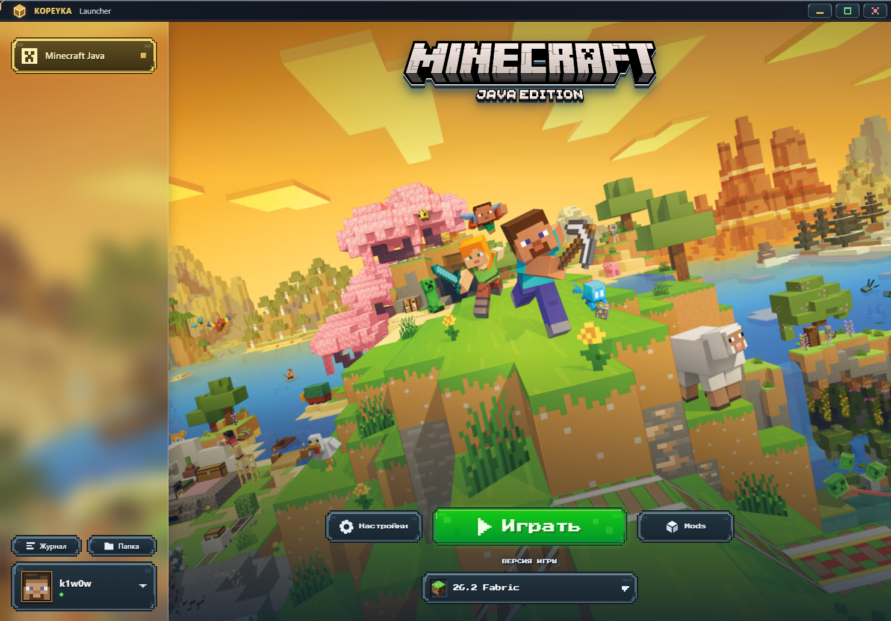

# KOPEYKA Launcher

Лаунчер Minecraft Java для Windows с пиксельными кнопками, прозрачными панелями и живым фоном, который реагирует на движение мыши.

## Скачать 0.1.2 Beta

[Скачать EXE-установщик](https://github.com/Arab228d/kopeyka-launcher/releases/download/v0.1.2-beta/KOPEYKA-Laucher-Setup-0.1.2-beta.exe) · [Страница выпуска](https://github.com/Arab228d/kopeyka-launcher/releases/tag/v0.1.2-beta)

Установщик для Windows x64 создаёт ярлыки на рабочем столе и в меню «Пуск». Electron и Java 8, 16, 17, 21 и 25 включены: отдельно устанавливать Node.js или Java не нужно. Minecraft скачивается при первом запуске, поэтому нужен интернет.



## Возможности

- Сохранённые каталоги доступны сразу, актуальные версии проверяются в фоне.
- Установка и запуск Minecraft Java. Актуальные релизы, тестовые и исторические версии доступны через настройки.
- Vanilla, Fabric, Forge, NeoForge и OptiFine в общем выборе версии. Совместимые загрузчики скачиваются автоматически; доступность зависит от версии Minecraft.
- До 15 локальных профилей с разными никами: пиксельные карточки с аватарами и золотое выделение активного игрока.
- Mods: импорт своих JAR-файлов, изображения установленных модов, включение и выключение. Каталог модов в интерфейс не включён.
- Каталог шейдеров с изображениями и установкой через Modrinth. Для работы шейдеров нужен совместимый графический мод, например Iris или OptiFine.
- Окно «Что нового» после обновления и повторный просмотр изменений в настройках. Логотип загрузки также используется на ярлыке приложения.
- Проверка новых выпусков на GitHub и обновление установщика по кнопке с проверкой SHA-256.
- Плавное появление интерфейса, движение фона, прозрачные панели, свечение пиксельных кнопок и собственная панель окна.
- Во время запуска фон приближается, появляется «Загрузка игры». Лаунчер скрывается после готовности Minecraft и возвращается после выхода.
- Общие миры между сборками, перенос последних настроек Minecraft и счётчик времени игры. При первом запуске язык Minecraft выбирается по языку системы; ручной выбор сохраняется.
- Журнал запуска с сохранением в файл для диагностики.

## Настройки и миры

Данные лаунчера находятся в `%USERPROFILE%\.kopeyka\launcher`, стандартная папка игры — `%USERPROFILE%\.kopeyka\minecraft`. Обновление приложения не меняет эти папки. Пользовательскую папку игры можно выбрать в настройках.

Старые настройки импортируются автоматически. Данные из прежней стандартной папки AppData копируются в новую, исходные файлы сохраняются. При объединении миров совпадающие имена не перезаписываются, старые папки миров остаются в резервных `saves-before-shared`.

Моды изолированы по версии и загрузчику; миры общие. Перед открытием важного мира в другой версии Minecraft сделайте резервную копию: совместимость формата мира зависит от самой игры.

## Статус выпуска

**0.1 Beta** — новый номер текущей линейки. Если уже установлена сборка 0.2.x или 0.3.0, установите эту Beta вручную: автоматическое сравнение версий не предлагает переход на меньший номер. Последующие выпуски продолжат новую нумерацию.

Используются локальные профили без Microsoft-входа. Подключение к серверам с официальной авторизацией требует лицензионного входа, который пока не реализован. EXE не подписан. Лаунчер не связан с Mojang или Microsoft; игровые файлы не входят в установщик.

## Разработка

Требуется Node.js. В папке проекта:

```powershell
npm ci
npm start
```

Проверки и сборка:

```powershell
npm test
npm run test:ui
npm run build:installer
```

Установщик появится в `dist/`. Сборка готовит Java по `build/runtime-lock.json`, проверяет контрольные суммы и включает лицензии. Игровые данные не входят в исходники или сборку.

`src/ui/` содержит интерфейс, `src/main.js` — окно и операции, `src/installer.js` — загрузку Minecraft, `src/loaders.js` — загрузчики, `src/game-data.js` и `src/persistence.js` — сохранение данных.
